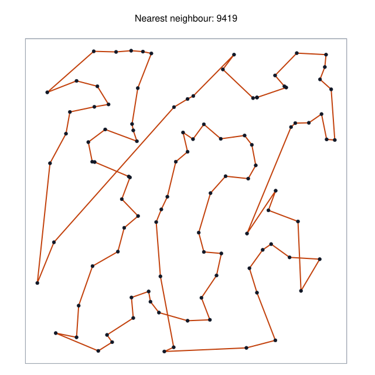
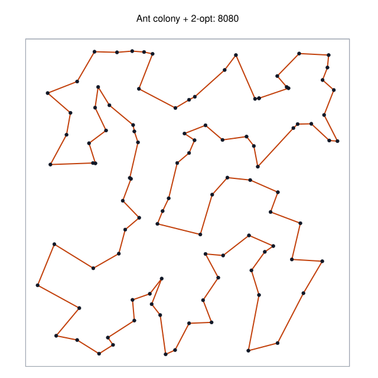
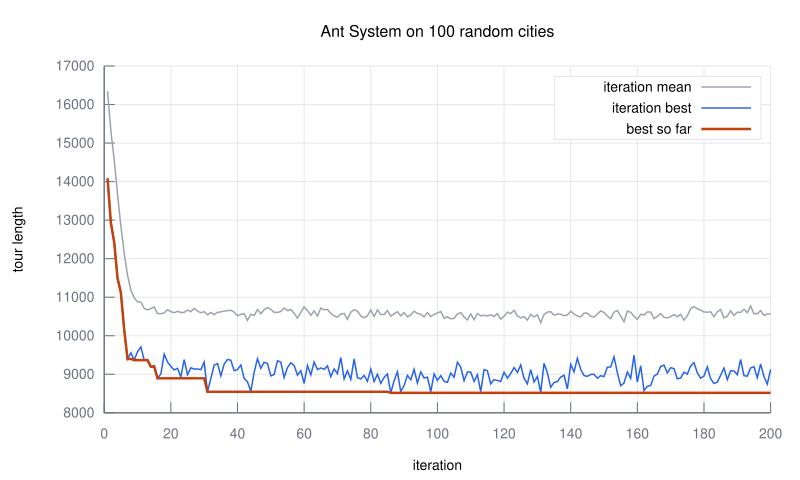

<div align="center">

# aco-tsp

**Ant colony optimisation for the travelling salesman problem.**<br>
A small, tested C11 library and command-line tool.

[](https://github.com/DmytroPalahin/aco-tsp/actions/workflows/ci.yml)
[](https://github.com/DmytroPalahin/aco-tsp/actions/workflows/codeql.yml)
[](https://github.com/DmytroPalahin/aco-tsp/releases)
[](LICENSE)
<br>


[](CONTRIBUTING.md)

[Quick start](#quick-start) ·
[Usage](#command-line-usage) ·
[Library](#using-the-library) ·
[How it works](#how-it-works) ·
[Results](#results) ·
[Report (PDF)](report/report.pdf)

</div>

<table>
  <tr>
    <td></td>
    <td></td>
  </tr>
  <tr>
    <td align="center">A greedy tour of 100 random cities…</td>
    <td align="center">…and the one the colony finds: 14 % shorter.</td>
  </tr>
</table>

## About

A salesman must visit `n` cities once each and come home, driving as little
as possible. The problem is NP-hard, so beyond a couple of dozen cities
exact methods give way to heuristics. This one imitates ants: many simple
agents build tours at random, biased towards short edges and towards edges
that earlier good tours have marked with *pheromone*. Good edges are
reinforced, the rest evaporates, and the colony converges on a short tour.

The project started in 2023 as second-year coursework at Sup Galilée
(Université Sorbonne Paris Nord), written with a classmate. Version 2 is a
complete rewrite as a reusable library with a proper test suite; the
original submission is kept, as it was, in [`archive/`](archive/README.md).

## Features

- **Ant System**, plus three classic refinements that can be switched on
  independently: elitist reinforcement, greedy exploitation (the rule of Ant
  Colony System) and a **2-opt local search**.
- **Reference solvers** to compare against: nearest neighbour, 2-opt, and
  an **exact** Held–Karp solver for up to 20 cities.
- Reads the triangular format of the assignment and **TSPLIB** files
  (`EUC_2D`, `CEIL_2D`, `EXPLICIT`); writes tours, per-iteration traces
  and plot data.
- **Reproducible**: its own seeded generator gives the same run for the
  same seed on every platform.
- **A library first**: a documented C API with opaque handles and error
  values, installable as a CMake package (`aco::aco`). No dependency beyond
  the C standard library.
- **Tested**: unit tests, end-to-end tests, a fuzzer for the parser;
  sanitizers, Valgrind, clang-tidy and CodeQL in CI on Linux, macOS and
  Windows.

## Quick start

You need a C11 compiler and CMake 3.25 or newer.

```bash
git clone https://github.com/DmytroPalahin/aco-tsp.git
cd aco-tsp
cmake --workflow --preset release      # configure, build, run the tests
```

Solve one of the bundled instances:

```console
$ build/release/aco-tsp solve data/random/random100.tsp --seed 1 --local-search 2opt
instance     random100 (100 cities)
algorithm    ant colony optimisation
parameters   ants=100 iterations=200 alpha=1 beta=3 rho=0.5 deposit=1
             tau0=0.009882 q0=0 elitist=0 local-search=2opt
seed         1
iterations   200 (best tour found at iteration 55)
time         0.582 s
length       8080
tour         1 2 58 54 12 4 38 13 18 78 80 26 39 77 69 81 65 53 64 84 15 74 9
             8 29 24 86 30 55 93 63 23 76 71 41 94 96 48 6 89 52 75 37 50 92 7
             ...
```

Without presets, the usual three commands work too:

```bash
cmake -S . -B build -DCMAKE_BUILD_TYPE=Release
cmake --build build
ctest --test-dir build
```

To install the tool, the library and its CMake package:

```bash
cmake --install build --prefix ~/.local
```

## Command-line usage

```text
aco-tsp solve <instance> [options]     find a short tour
aco-tsp generate --cities N [options]  create a random Euclidean instance
aco-tsp help [command]                 show help
```

### Examples

```bash
# The assignment's 50-city instance, default parameters
aco-tsp solve data/course/tsp050.txt

# The same, reinforcing the best tour found so far
aco-tsp solve data/course/tsp050.txt --elitist 50 --seed 7

# Prove the optimum of a small instance
aco-tsp solve data/course/tsp020.txt --algorithm exact

# Create 200 random cities, solve them, and draw the result
aco-tsp generate --cities 200 --seed 3 --output cities.tsp
aco-tsp solve cities.tsp --local-search 2opt --plot tour.dat --trace trace.csv
gnuplot -e "input='tour.dat'; output='tour.svg'" scripts/plot-tour.gp
gnuplot -e "input='trace.csv'; output='trace.svg'" scripts/plot-trace.gp

# Only the tour length, for scripts
aco-tsp solve data/course/tsp100.txt --seed 1 --quiet
```

### Options of `solve`

| Option | Meaning | Default |
| --- | --- | --- |
| `-a`, `--algorithm NAME` | `aco`, `nearest-neighbour`, `two-opt` or `exact` | `aco` |
| `-m`, `--ants N` | number of ants | one per city |
| `-i`, `--iterations N` | number of iterations | 200 |
| `--alpha X` | weight of the pheromone, α | 1 |
| `--beta X` | weight of the visibility, β | 3 |
| `--rho X` | evaporation rate ρ, in [0, 1] | 0.5 |
| `--deposit X` | pheromone budget of one ant, Q | 1 |
| `--tau0 X` | initial pheromone τ₀ | ants · Q / greedy length |
| `--q0 X` | probability of a greedy move, in [0, 1] | 0 |
| `--elitist X` | extra weight of the best tour so far | 0 |
| `--local-search NAME` | `none` or `2opt` | `none` |
| `--patience N` | stop after N iterations without progress | off |
| `-s`, `--seed N` | random seed | from the clock |
| `-o`, `--tour FILE` | write the tour (TSPLIB format) | |
| `--trace FILE` | write per-iteration statistics (CSV) | |
| `--plot FILE` | write the tour as `x y` lines for gnuplot | |
| `-q`, `--quiet` | print only the tour length | |

`aco-tsp generate` takes `--cities`, `--extent`, `--seed`, `--format`
(`tsplib` or `triangular`) and `--output`. The input and output formats are
specified in [docs/file-formats.md](docs/file-formats.md).

## Using the library

```c
#include <aco/aco.h>
#include <stdio.h>

int main(void)
{
    aco_instance *instance = NULL;
    aco_tour tour = ACO_TOUR_INIT;
    aco_error error = ACO_ERROR_INIT;
    aco_params params = aco_params_default();

    params.local_search = ACO_LOCAL_SEARCH_TWO_OPT;
    params.seed = 42;

    if (aco_instance_load("cities.tsp", &instance, &error) == ACO_OK &&
        aco_solve(instance, &params, &tour, &error) == ACO_OK) {
        printf("best tour: %g\n", tour.length);
    } else {
        fprintf(stderr, "error: %s\n", error.message);
    }

    aco_tour_free(&tour);
    aco_instance_destroy(instance);
    return 0;
}
```

```cmake
find_package(aco 2 REQUIRED)
target_link_libraries(my_program PRIVATE aco::aco)
```

For finer control, create an `aco_colony` and call `aco_colony_step()`
yourself, or pass an observer to `aco_colony_run()`:
[`examples/convergence.c`](examples/convergence.c) shows both. Every public
function is documented in the headers under [`include/aco`](include/aco);
`cmake --build build --target docs` renders them with Doxygen.

## How it works

At each iteration every ant builds a complete tour. Standing in city $i$,
ant $k$ moves to a city $j$ it has not visited yet with probability

$$
p_{ij}^{k} \;=\; \frac{\tau_{ij}^{\alpha}\,\eta_{ij}^{\beta}}
                      {\sum_{l \,\in\, \text{unvisited}} \tau_{il}^{\alpha}\,\eta_{il}^{\beta}},
\qquad \eta_{ij} = \frac{1}{d_{ij}},
$$

where $\tau_{ij}$ is the pheromone on the edge and $\eta_{ij}$ its
*visibility*: close cities are attractive. When all the ants are back, the
pheromone evaporates and each ant reinforces the edges of its tour in
proportion to the quality of that tour, of length $L_k$:

$$
\tau_{ij} \;\leftarrow\; (1-\rho)\,\tau_{ij} \;+\; \sum_{k \,:\, (i,j) \,\in\, T_k} \frac{Q}{L_k}.
$$

Short tours lay more pheromone, so their edges are chosen more often, so
they are explored further: a positive feedback that evaporation keeps from
locking in too early. With one ant per city an iteration costs $O(n^3)$.

The options add what the literature found to help most:

- `--elitist e` lets the best tour found so far deposit `e` extra shares;
- `--q0` makes an ant take the single most attractive edge with that
  probability instead of drawing at random;
- `--local-search 2opt` untangles every tour before it lays pheromone, which
  turns the colony into a guided multi-start local search.

The [report](report/report.pdf) derives all of this, discusses the
implementation and presents the experiments. The code is mapped out in
[docs/architecture.md](docs/architecture.md).

## Results

Tour lengths on the assignment's instances and on 100 random cities.
Colony results are the **mean of 20 seeds** (best run in parentheses), 200
iterations, one ant per city, default parameters. The baselines try every
starting city and keep the best tour. Lower is better.

| Instance | Cities | Optimum | Nearest neighbour | NN + 2-opt | Ant System | Elitist AS | AS + 2-opt |
| --- | ---: | ---: | ---: | ---: | ---: | ---: | ---: |
| `tsp020` | 20 | 201 | 274 | 210 | 213.2 (201) | 205.6 (201) | **201.0** (201) |
| `tsp030` | 30 | – | 344 | 257 | 267.1 (258) | 257.2 (245) | **242.1** (240) |
| `tsp040` | 40 | – | 374 | 272 | 296.1 (288) | 284.2 (271) | **264.1** (263) |
| `tsp050` | 50 | – | 383 | 293 | 293.9 (268) | 266.6 (256) | **258.0** (254) |
| `tsp100` | 100 | – | 3464 | 2801 | 3019.3 (2892) | 2769.2 (2573) | **2620.9** (2552) |
| `random100` | 100 | – | 9419 | 8277 | 8442.0 (8347) | 8239.2 (8111) | **8068.4** (8027) |

On 500 small random instances whose optimum was proven with the exact
solver (8 to 16 cities), plain Ant System found the optimum in 89 % to
100 % of the runs and the hybrid with 2-opt in **all of them**.

<p align="center">
  
</p>

Everything above is reproducible: `scripts/run-experiments.sh` regenerates
the data behind every table and figure of the report in a few minutes.

## Project layout

```text
include/aco/    public headers: the API of the library
src/            the library (colony, heuristics, exact solver, instance I/O, RNG)
src/cli/        the aco-tsp command-line tool
tests/          unit tests (one program per module) and end-to-end tests of the tool
fuzz/           libFuzzer harness for the instance parser, with a seed corpus
examples/       two small programs that use the library
data/           instances: the assignment's, and reproducible random ones
scripts/        experiment runner and gnuplot scripts
report/         the report (LaTeX source, generated data, PDF)
docs/           architecture, file formats, figures
cmake/          build helpers
archive/        the 2023 coursework, unmodified
```

## Development

```bash
cmake --workflow --preset dev        # debug build, warnings as errors, all tests
cmake --workflow --preset sanitize   # the same under ASan and UBSan
cmake --build build/dev --target format
```

[CONTRIBUTING.md](CONTRIBUTING.md) covers the presets, the fuzzer, the
coding conventions and the release process. CI runs the same presets on
Linux (GCC, Clang), macOS (Apple Clang) and Windows (MSVC), and adds
Valgrind, clang-tidy, CodeQL, a one-minute fuzzing run and a 90 % coverage
floor.

## Roadmap

- MAX–MIN Ant System and the full Ant Colony System (local pheromone update)
- Candidate lists and don't-look bits, to scale 2-opt beyond a few thousand cities
- Building the ants' tours in parallel
- More TSPLIB distance types (`GEO`, `ATT`) and asymmetric instances

Ideas and pull requests are welcome: see [CONTRIBUTING.md](CONTRIBUTING.md).

## Documentation

| | |
| --- | --- |
| [Report (PDF)](report/report.pdf) | The problem, the algorithm, the implementation and the experiments |
| [docs/architecture.md](docs/architecture.md) | How the code is organised, and why |
| [docs/file-formats.md](docs/file-formats.md) | Input and output formats |
| [data/README.md](data/README.md) | The bundled instances and their best known tours |
| [CHANGELOG.md](CHANGELOG.md) | What changed between versions |
| [`include/aco`](include/aco) | API reference, in the headers |

## Authors and acknowledgements

Written and maintained by [Dmytro Palahin](https://github.com/DmytroPalahin).
The original 2023 coursework was a two-person project for a course taught by
Frédéric Roupin, who set the subject and provided the instances. Full
credits are in [AUTHORS.md](AUTHORS.md).

<a href="https://github.com/DmytroPalahin/aco-tsp/graphs/contributors">
  
</a>

The algorithm is Ant System, by M. Dorigo, V. Maniezzo and A. Colorni
(1996). The random generator is xoshiro256** by D. Blackman and S. Vigna.

If you use this software in academic work, please cite it using
[CITATION.cff](CITATION.cff).

## License

[MIT](LICENSE) © Dmytro Palahin
