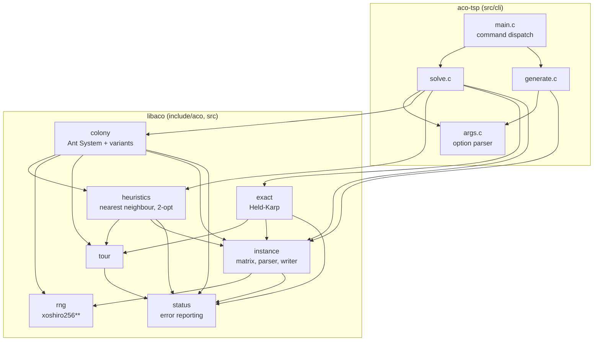

# Architecture

This document explains how the code is organised and why. The algorithm
itself is described in the [report](../report/report.pdf); the public API is
documented in the headers under [`include/aco`](../include/aco).

## Overview

The project is a static library, `libaco`, and a thin command-line tool,
`aco-tsp`, built on top of it. Everything the tool can do, a program linking
the library can do too.

The arrows only ever point downwards: there is no cyclic dependency, and
each module can be read and tested with the ones below it.

## Modules

| Module | Files | Responsibility |
| --- | --- | --- |
| `status` | `status.h`, `status.c` | Status codes, `aco_error` messages, library version |
| `rng` | `rng.h`, `rng.c` | xoshiro256** generator seeded with SplitMix64 |
| `instance` | `instance.h`, `instance.c`, `instance_parse.c`, `instance_write.c` | Validated distance matrix; triangular and TSPLIB I/O; random generator |
| `tour` | `tour.h`, `tour.c` | A permutation with its length; validation, rotation, TSPLIB output |
| `heuristics` | `heuristics.h`, `heuristics.c` | Nearest-neighbour construction and 2-opt improvement |
| `exact` | `heuristics.h`, `exact.c` | Held-Karp dynamic programme, for up to 20 cities |
| `colony` | `colony.h`, `colony.c` | Parameters, the simulation loop, stopping rules |
| tool | `src/cli/*` | Option parsing, file output, human-readable reports |

`src/internal.h` holds the few declarations the library modules share
without exposing them: the layout of `aco_instance`, the error helper and
the raw-array kernels (`aco_cycle_length`, `aco_two_opt_cycle`) that the
colony calls directly on its own buffers.

## Design decisions

### A library first

The 2023 version was four near-identical `main` functions of 290 to 440
lines. The rewrite puts the algorithm behind an API so that it can be tested
in isolation, reused, and driven step by step (`aco_colony_step`) as well as
to completion (`aco_colony_run`, `aco_solve`).

### Opaque handles for invariants, plain structs for data

`aco_instance` and `aco_colony` are opaque: they can only be created through
functions that validate their input, so the rest of the code may assume a
square, symmetric, finite, non-negative matrix with a zero diagonal. No
function further down re-checks it.

`aco_tour`, `aco_params` and `aco_iteration` are plain structs: they are
data, and hiding them behind accessors would only add ceremony.

### Errors are values

Every fallible function returns an `aco_status`. Where a failure deserves an
explanation (a malformed file, a parameter out of range) the function also
fills an optional `aco_error` with a message that names the line or the
offending value. Nothing is printed by the library and nothing calls
`exit`.

Internally, `ACO_FAIL(error, status, "format", ...)` records the message and
evaluates to `status`. It is a macro, not a function, so that compilers and
static analysers can see which status a function returns.

### Flat, zero-based matrices

The original code declared `float Distance[N][N]` on the stack and indexed
it from 1 to N, writing one element past each row and past the array. The
rewrite stores every matrix as one heap block of `n * n` doubles in row-major
order, indexed from zero as `matrix[i * n + j]`. Cities are converted to
1-based numbers only at the boundary, when files are read or written.

### The hot loop

One iteration costs `O(ants * n^2)`. Three choices keep the constant small:

1. `tau^alpha * eta^beta` is computed **once per iteration** for every edge
   (`refresh_attraction`), not once per decision. `eta^beta` never changes
   and is computed once per run.
2. The cities an ant may still visit are kept in a **compact array**; a
   visited city is removed by swapping the last one into its place. The
   original scanned the route to answer "was this city visited?", which
   made tour construction cubic for a single ant.
3. No memory is allocated inside the loop: the colony owns all its buffers.

### Numerical robustness

- Visibility is measured relative to the shortest positive distance, so
  `eta` lies in `(0, 1]` and `eta^beta` cannot overflow.
- Coincident cities (distance zero) receive the maximum visibility instead
  of a division by zero.
- If every candidate weight underflows to zero (very large `alpha` or
  `beta`), the ant falls back to a uniform choice instead of dividing by
  zero.
- 2-opt only accepts an exchange that improves the tour by a relative
  margin, which rules out endless oscillation on rounding noise.

### Determinism

`rand()` differs between C libraries, has global state and, used as
`rand() % 100`, gave the original roulette wheel a resolution of 1 %. The
library carries its own generator: the same seed gives the same run on every
platform, each colony has its own stream, and reproducing a bug report only
takes the instance and the seed.

### Parsing untrusted input

The parser works on a memory buffer, never on a `FILE`. That makes it
trivially testable and fuzzable (`fuzz/fuzz_instance_parse.c`). It checks
that the input is long enough for the size it announces *before* allocating
the matrix, so a ten-byte file cannot request gigabytes.

## Testing strategy

| Layer | Where | What it checks |
| --- | --- | --- |
| Unit tests | `tests/test_*.c` | Each module through the public API, including every error path that does not need an allocation to fail |
| Reference results | `tests/test_heuristics.c` | Held-Karp against brute force; 2-opt against a closed-form optimum |
| Properties | `tests/test_colony.c` | Determinism, monotonic best tour, pheromone formula on a hand-computed case |
| End to end | `tests/cli/run.cmake` | Exit codes, messages and output files of the tool |
| Fuzzing | `fuzz/` | The parser, under AddressSanitizer and UndefinedBehaviorSanitizer |
| Dynamic analysis | CI | The whole suite under ASan/UBSan and under Valgrind |
| Static analysis | CI | clang-tidy with warnings as errors, CodeQL |

Tests of solution quality compare against proven optima and leave a
documented margin, because the search is stochastic.

## Build system

`CMakeLists.txt` defines the library, the tool, the install rules and a
CMake package (`find_package(aco)` gives the target `aco::aco`).
`cmake/AcoTargetDefaults.cmake` applies the warning set and the optional
instrumentation to each target privately, so that nothing leaks into
projects that consume the library. `CMakePresets.json` names the
configurations used by developers and by CI, which therefore run exactly the
same commands.
